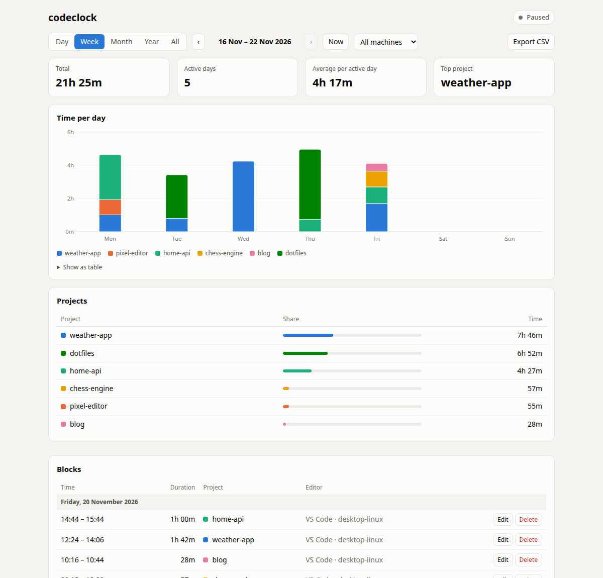
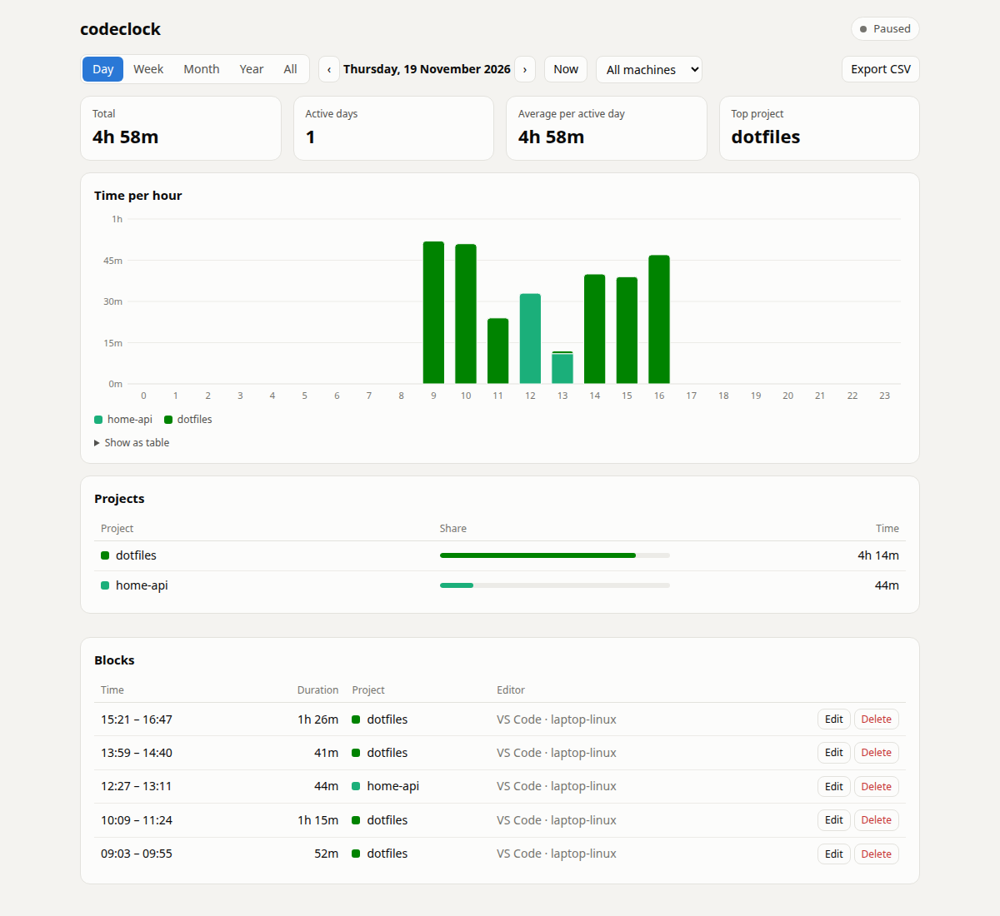
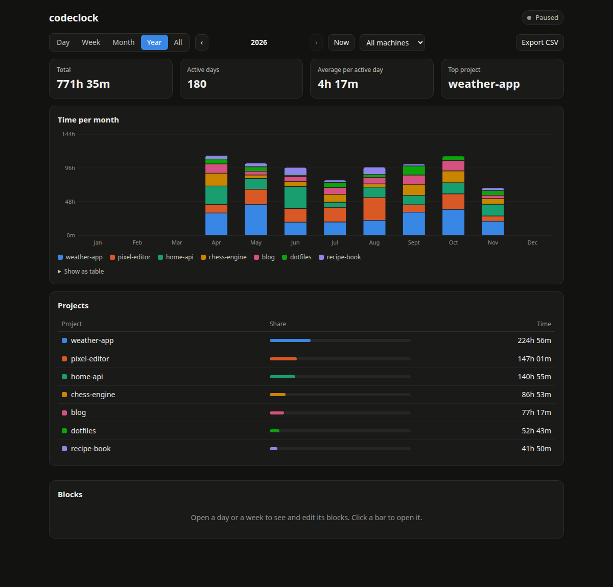
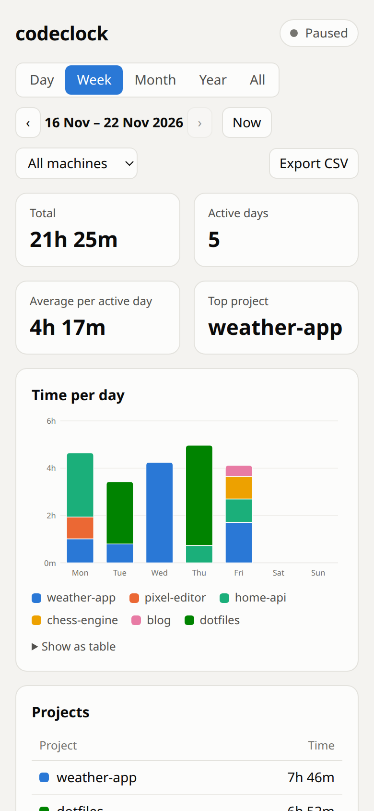

# codeclock

codeclock measures how long you really spend coding on each project. It runs in the background and counts only while your editor has focus, the screen is unlocked, and you have used the keyboard or mouse in the last 5 minutes, so browsing, meetings and coffee breaks never inflate the numbers.

It does not depend on any editor or desktop: it is a small standalone Rust program for Linux, with an optional tray icon, a local history dashboard and optional syncing between your machines.



## How time is counted

- **Only real editor work counts.** Time in a browser, a terminal, or the app you are testing does not count, even if the editor is open behind it.
- **Short pauses count.** Stopping to read or think for a few minutes is part of the work.
- **Long pauses are taken off completely.** Once you have been idle for 5 minutes (configurable), the whole pause is removed, not just the part after the limit. The block ends at your last input.
- **A locked screen or a suspended machine never counts.**
- **One project at a time.** Switching to another project's window closes the current block and starts a new one.

## Supported systems

| Desktop | Status |
| --- | --- |
| GNOME on X11 | Supported |
| GNOME on Wayland | Supported for apps under XWayland (VS Code in X11 mode) |
| KDE Plasma 5 and 6, Wayland or X11 | Supported (through a KWin script) |
| Other X11 desktops and window managers | Supported; idle time depends on the desktop |
| Sway, Hyprland, Windows, macOS | Not yet |

Each desktop has its own small caveats (tray icons, idle time, lockers, editor flags): see [Desktops and systems](docs/desktops.md). All guides are in [docs/](docs/README.md).

## Install

Download the Linux binary from the [releases](https://github.com/tugapse/codeclock/releases) (needs glibc 2.39 or newer), or build it:

```sh
cargo build --release                       # Rust 1.88 or newer; SQLite is bundled
install -m 755 target/release/codeclock ~/.local/bin/codeclock
codeclock init-config        # writes ~/.config/codeclock/config.toml with the defaults
codeclock install-service    # systemd user service, starts with the graphical session
```

Check that it sees your editor. Focus a VS Code window, then from another window run:

```sh
sleep 3; codeclock status    # gives you 3 seconds to switch back to the editor
```

It needs systemd (logind) and a D-Bus session. If something is missing, see [Troubleshooting](docs/troubleshooting.md).

**Upgrading from playtime:** codeclock used to be called playtime. Install the `codeclock` binary and run `codeclock install-service`: the first run stops the old service and moves your config, database and sync clone to the new folders. Then delete `~/.local/bin/playtime`.

## Usage

```sh
codeclock report             # today, per project
codeclock report --week      # since Monday
codeclock report --all       # all time
codeclock status             # what it sees now: window, editor, project, idle time, lock
codeclock open               # open the history dashboard in the browser
codeclock sync               # sync with your other machines now
```

The tray icon shows the current project, today's time and the project's all-time total in its tooltip and menu.

## History dashboard

The service serves a dashboard at <http://127.0.0.1:8417>. Open it with `codeclock open`, a left click on the tray icon, or "Open history" in its menu.

- **Periods:** day, week, month, year or all time, with ‹ › (or the arrow keys) to move between them. Click a bar to open that day or month.
- **Projects and machines:** totals and share for the period. Click a project to show only that one; pick a machine to see only its time.
- **Blocks:** in day and week views, every block can be edited (start, end, project) or deleted. The block being counted right now cannot be changed until it ends, and edits that would overlap another block of the same project are refused.
- **Export CSV:** the blocks of the period on screen, clipped to it, so the durations add up to the totals shown.

| Day view with its blocks | Year view, dark mode | On a phone |
| --- | --- | --- |
|  |  |  |

The screenshots use sample data.

Only this machine can reach the dashboard: it listens on 127.0.0.1, rejects requests for any other host name, and only accepts changes sent by its own page. Set `dashboard_port = 0` to turn it off.

## Syncing between machines

```sh
gh repo create codeclock-data --private          # once, from any machine
codeclock sync init https://github.com/you/codeclock-data.git
systemctl --user restart codeclock
```

Run `codeclock sync init` on every machine. Each one counts locally and syncs through the private repository when the service starts, every 15 minutes, when it stops, and when you open the dashboard. Projects are named after their git repository, so the same project counts as one everywhere, whatever its folder is called. Details and caveats: [Syncing between machines](docs/sync.md).

## Configuration

`~/.config/codeclock/config.toml`. Every key is optional; missing keys keep their default.

```toml
idle_timeout_secs = 300      # a pause this long or longer stops counting, all of it
sample_secs = 5              # how often the focused window is checked
project_roots = ["~/Code"]   # every direct subfolder is a project
dashboard_port = 8417        # history dashboard on 127.0.0.1; 0 turns it off

[[editors]]
name = "VS Code"
window_classes = ["code", "Code", "code_code", "code-url-handler"]   # code_code = snap
process_names = ["code", "code-oss", "codium"]

[sync]
machine = ""                 # name in the sync repository; empty = <hostname>-<os>
interval_secs = 900          # how often the service syncs
```

Other editors, how projects are found and named, and per-editor caveats: [Editors and projects](docs/editors-and-projects.md).

## Data

Everything is stored on your machine, in `~/.local/share/codeclock/codeclock.db` (SQLite). Each row is one continuous block of work:

```sql
blocks(id, uuid, machine, project, editor, start, end, updated_at, deleted, synced)
-- start, end and updated_at are Unix seconds
```

All blocks are your time; `editor` only says which editor it was counted in. Deleted blocks are only marked, so the deletion can sync. With sync turned on, changes also go to your private repository as described in [Syncing between machines](docs/sync.md).

## Uninstall

```sh
systemctl --user disable --now codeclock.service
rm ~/.config/systemd/user/codeclock.service ~/.local/bin/codeclock
rm -r ~/.config/codeclock ~/.local/share/codeclock   # also deletes your recorded time
```

## Roadmap

- Focus modules for Sway, Hyprland and GNOME on Wayland, and a basic mode for desktops without one.
- Windows support.
- Counting time spent by AI agents working on a project.
